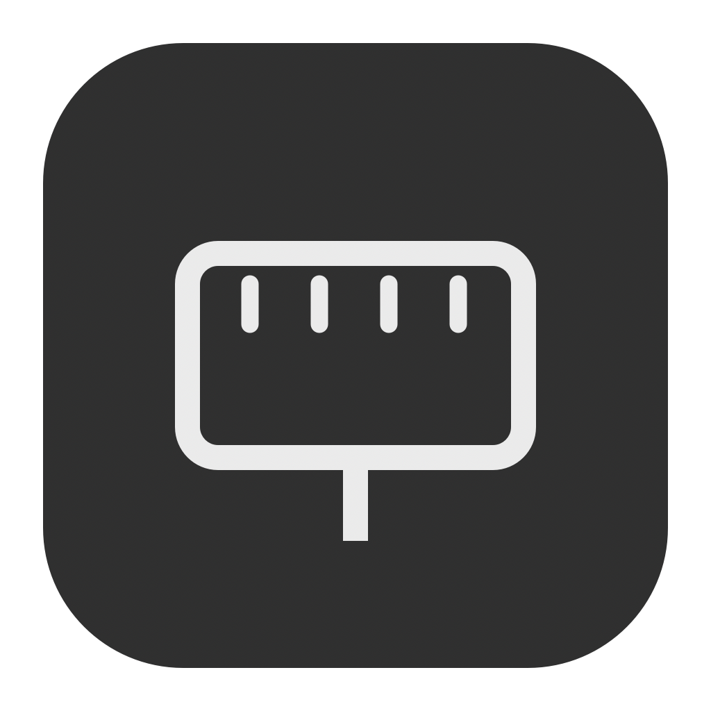
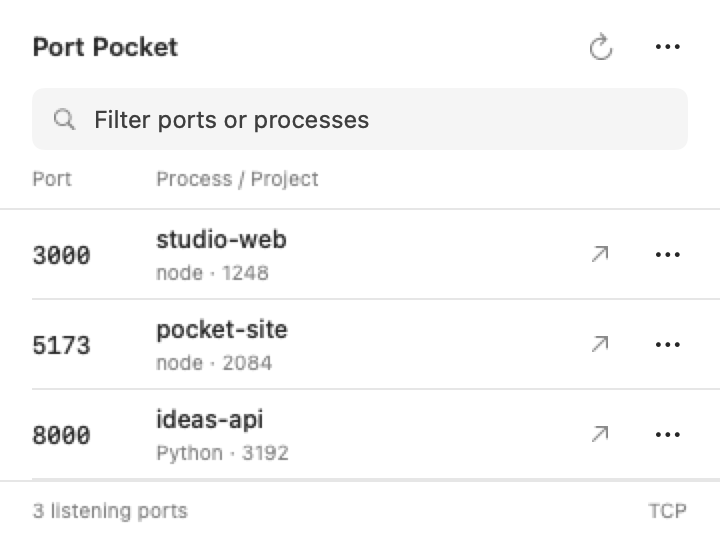
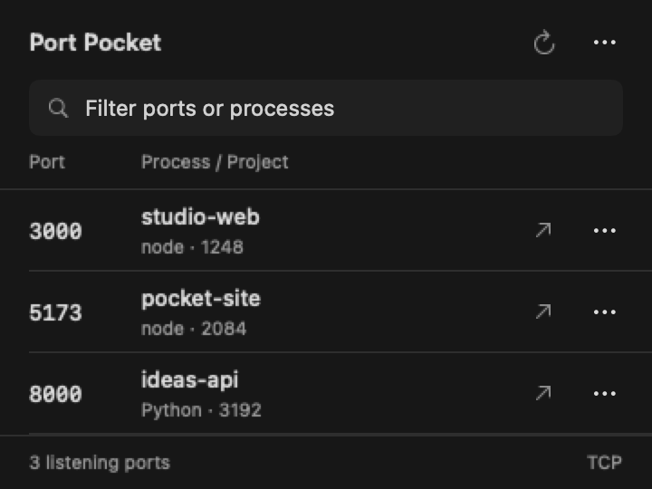

<p align="center"></p>
<h1 align="center">Port Pocket</h1>
<p align="center">Local ports. Process details. One menu-bar utility.</p>
<p align="center">
<a href="https://github.com/sayyidsyamil/port-pocket/actions/workflows/build.yml"></a>

<a href="LICENSE"></a>
</p>

A minimal native macOS menu-bar app for discovering and managing local TCP listening ports. Built with Swift and SwiftUI, without third-party dependencies.

**Preview v0.1.0.** Build from source using the instructions below. Signed, notarized installers are planned; they are not available yet.

<p align="center">


</p>

## What it does

- Lists listening TCP ports with process names, PIDs, and working-directory/project names.
- Searches by port, project, process, PID, or folder path.
- Opens localhost URLs in the browser, with HTTP and HTTPS options.
- Copies a server URL or reveals its project directory in Finder.
- Stops a process with confirmation using a graceful `SIGTERM` request.
- Refreshes every eight seconds while the panel is open and whenever you open it.
- Hides a small list of system services by default; enable them in Settings.
- Supports native light/dark appearance and launch at login.

## Build and install

Requires **macOS 13+** and Apple Command Line Tools.

```bash
xcode-select --install  # if developer tools are not installed
git clone https://github.com/sayyidsyamil/port-pocket.git
cd port-pocket
bash scripts/install.sh
```

The install script builds and checks the app before copying it to your Applications folder. To build without installing, run `bash scripts/build.sh`.

The app is installed to **`~/Applications/Port Pocket.app`**. Click the connected-drive icon in the menu bar to open it. If the notch or other icons hide it, hold **⌘ Command** and drag it closer to the clock.

The preview uses a local ad-hoc signature. It is not Developer ID signed or notarized. Builds target the architecture of the Mac running the script.

## Use it

1. Start a local development server, such as Vite, Next.js, or a Python HTTP server.
2. Open Port Pocket and find its port.
3. Click the **↗** button to open `http://localhost:PORT`.
4. Use the row’s **⋯** menu to copy the URL, use HTTPS, reveal its folder, or stop the process.
5. Enter a port number in search when diagnosing an “address already in use” conflict.

**Stopping a process closes all of its ports**, not only the row you selected. Port Pocket confirms before stopping, verifies the executable and listener identity again, limits stopping to your user’s processes, and protects a small list of macOS services. A supervisor may restart a stopped process. It never escalates privileges or sends `SIGKILL`.

## What the list means

The list comes from macOS `lsof`; it shows **TCP listeners visible to your user**, not just websites. Some ports are databases, debugging endpoints, or other services, so opening them in a browser may not work. UDP ports and other users’ inaccessible processes are outside this preview’s scope.

Project names are inferred from process working directories. A process launched from your home folder may show that folder rather than its true project name. Duplicate IPv4/IPv6 sockets for the same process and port are grouped into one row. Binding addresses are available in each row’s action menu. A wildcard address (`*`) means all interfaces; Port Pocket does not change network exposure.

No probes are sent to discovered ports. Network activity occurs only when you explicitly open a URL in your browser. The app does not collect analytics, upload process information, or require an account. Clipboard content changes only when you choose **Copy URL**.

## Troubleshooting

| Problem | What to check |
| --- | --- |
| Icon is missing | Reveal the menu bar in full-screen mode; move crowded icons away from the notch with ⌘-drag. |
| A server is missing | Click Refresh. Only TCP listeners visible to your user are shown. Enable Show system services if necessary. |
| Browser cannot connect | The port may not speak HTTP. Try HTTPS if appropriate, or use the service’s own client. |
| Stop is unavailable | The process may belong to another user or be on the protected-services list. |
| Process returns after stopping | A supervisor or development watcher may have restarted it. Stop that supervisor separately. |
| Project name looks wrong | The label is based on the process working directory, not a framework-specific project lookup. |

For a reproducible issue, use the [bug report form](https://github.com/sayyidsyamil/port-pocket/issues/new?template=bug_report.yml).

## Checks

```bash
# Parser and process-protection checks (also run by the build script):
"build/Port Pocket.app/Contents/MacOS/PortPocket" --self-test

# Creates a disposable HTTP server on an available port, discovers it,
# gracefully stops only that test server, and verifies the port is released:
"build/Port Pocket.app/Contents/MacOS/PortPocket" --integration-test

# Print the actual listening ports:
"build/Port Pocket.app/Contents/MacOS/PortPocket" --scan
```

## Screenshots and icon

The checked-in light/dark screenshots render the real native interface with example server data, so they contain no private paths or running-process information.

```bash
"build/Port Pocket.app/Contents/MacOS/PortPocket" --capture-preview docs/screenshots
mkdir -p build/PortPocket.iconset
swift scripts/make-icon.swift build/PortPocket.iconset
iconutil -c icns build/PortPocket.iconset -o Resources/PortPocket.icns
```

## Uninstall

Disable **Launch at login** in the settings menu, quit Port Pocket, and move `~/Applications/Port Pocket.app` to the Trash. No privileged helpers are installed. Optionally remove preferences with `defaults delete io.portpocket.app`.

## Source layout

```text
Sources/Ports.swift   Listener discovery, parsing, process verification
Sources/main.swift    App lifecycle, refresh model, login item, test commands
Sources/Panel.swift   Minimal native panel
Resources/           App metadata and custom icon
scripts/             Build, installation, reproducible icon artwork
docs/                Light/dark screenshots
```

## Preview roadmap

- Signed and notarized downloadable builds.
- Favorites and custom port labels.
- Better project identification and framework hints.
- Richer port-conflict explanations.
- Universal Intel / Apple silicon packaging.

## Contributing

See [CONTRIBUTING.md](CONTRIBUTING.md) for setup, checks, and the interface guidelines. Bug reports and focused pull requests are welcome. For sensitive security issues, see [SECURITY.md](SECURITY.md).

## License

MIT. See [LICENSE](LICENSE).
